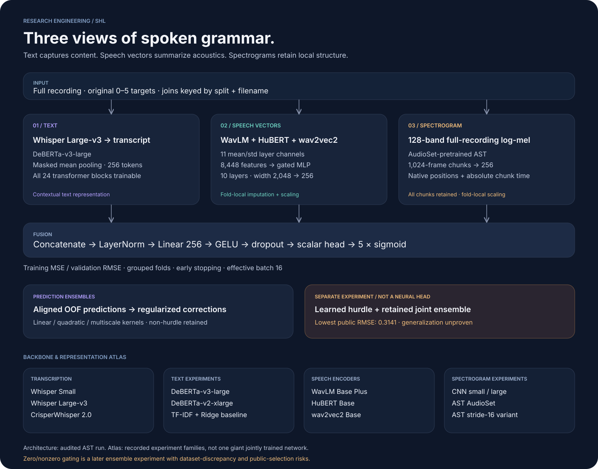
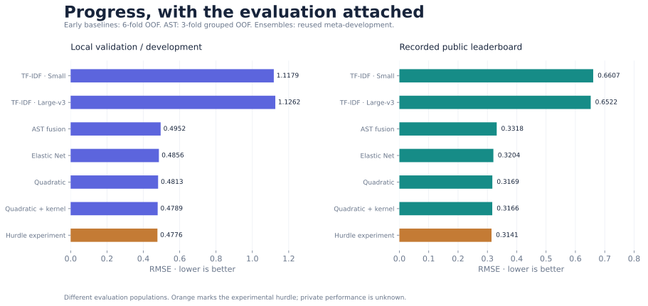
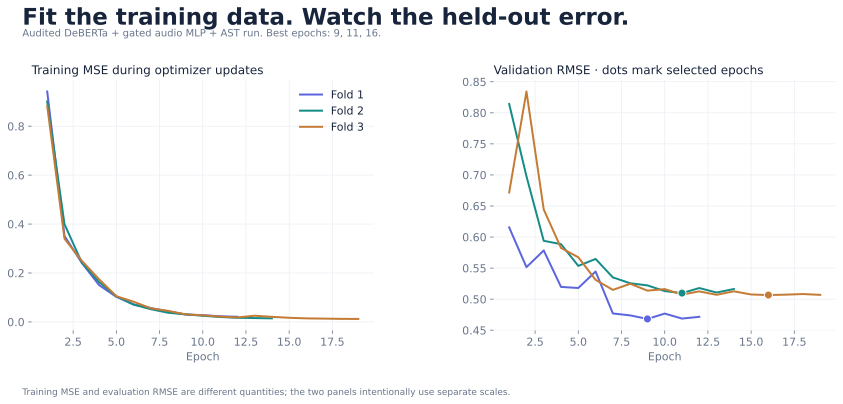

# SHL Grammar Scoring


**Training-data evaluation RMSE: 0.477589*** · **3 grouped folds** · **769 labelled recordings**  
**Recorded public leaderboard RMSE: 0.3141**

*The training-data figure is the pooled RMSE of the final ensemble's cross-fitted meta-development predictions across all three folds. It is not an in-sample training-fit score. Base OOF features were frozen, the full pipeline was not retrained inside every meta-fold, and final blend weights were selected using public feedback. This is a development estimate, not an independent generalization guarantee. Mean fold RMSE is 0.477121; pooled RMSE is the main reported figure. End-to-end in-sample training RMSE was not recorded.*

**Final submission notebook:** [final_submission.ipynb](final_submission.ipynb) includes the approach, preprocessing, architecture, evaluation report, fold scores, and code to verify the metric and reconstruct the submission from private archived predictions.

**Learning to assess spoken grammar from text, speech representations, and spectrograms.**

1. **Methodology: learn from prior work, turn it into experiments, and evaluate the result.**

   I began by reviewing related Kaggle competitions involving grammar and language-quality scoring to understand successful approaches and their limitations. I then studied arXiv research on audio processing and transformer representations, looking for ideas applicable to spoken grammar assessment. These findings guided a documented experiment plan: establish a simple baseline, compare transcription methods, explore text and audio representations, and combine complementary models. I used grouped cross-validation, RMSE, and error analysis to assess each iteration, while distinguishing improvements in public leaderboard performance from evidence of broader generalization.

   **Related Kaggle problems → audio research → documented hypotheses → experiments → error analysis**

   The assessment uses one grammar score on the original **0–5 scale**. Related essay-scoring tasks helped inform the text experiments; audio research guided the speech representations. Their inputs, targets, and validation settings differ, so I treated their findings as hypotheses to test on SHL.

   | Research question | How it shaped an experiment | What the evidence showed |
   |---|---|---|
   | What transfers from earlier language-scoring competitions? | Explore contextual DeBERTa representations and pooling diversity, informed by the saved Feedback Prize example | The resulting text models provided a starting point; source and audio errors motivated multimodal work |
   | Is the final speech-transformer layer the only useful representation? | Combine intermediate/final layer mean and standard-deviation features from WavLM, HuBERT, and wav2vec2 | These features entered the multimodal pipeline; a final-only ablation is still needed to isolate their contribution |
   | Does better transcription automatically improve grammar scoring? | Compare Small and Large-v3 transcripts with the same TF-IDF/Ridge configuration and folds | Larger ASR improved public RMSE but worsened local RMSE; the result was mixed |
   | Can combining models resolve their remaining errors? | Compare regularized ensembles and inspect shared residuals | Some ensembles improved public RMSE, while adding more models did not reliably help |

   Follow the [research journey](docs/RESEARCH.md), [annotated references](docs/REFERENCES.md), and [what worked / what did not](docs/WHAT_WORKED.md) for the reasoning and recorded results.

2. **Results, with the evaluation setting attached.** Public leaderboard results below are recorded observations from the experiment archive, not current rankings or private-test results.

   | Approach | Local evaluation | Recorded public RMSE |
   |---|---:|---:|
   | Whisper Small + word/character TF-IDF + Ridge | 1.11795, six-fold pooled OOF | 0.6607 |
   | Whisper Large-v3 + the same Ridge pipeline | 1.12624, six-fold pooled OOF | 0.6522 |
   | DeBERTa + pooled speech features + AST | 0.49524, three-fold grouped pooled OOF | 0.3318, full-data refit |
   | Elastic Net prediction ensemble | 0.48560, meta-development | 0.3204 |
   | Smooth quadratic prediction ensemble | 0.48128, meta-development | 0.3169 |
   | 11-model quadratic/kernel ensemble | 0.47893, meta-development | 0.3166 |
   | Experimental hurdle/joint blend | 0.47759, meta-development | **0.3141** |

   The last result reached **5th place at the recorded 15 October 2026 snapshot**. It is the lowest observed public RMSE in my records. I do **not** treat it as my strongest evidence of generalization: it explicitly models the zero/nonzero distinction in a dataset with unusual zero-labelled examples, and its final mixture was selected using public feedback. The private score is unknown. The non-hurdle ensemble is retained as an important comparison. Local and public scores evaluate different populations; early six-fold baselines and later grouped three-fold experiments also use different protocols.

3. **The pipeline at a glance.**

   

   The strongest audited individual model combines Whisper Large-v3 transcripts encoded by DeBERTa-v3-large, 11 pooled speech-encoder channels processed by a gated MLP, and full-recording log-mel spectrograms encoded by an AudioSet-pretrained AST. A bounded regression head predicts the grammar score. The gated MLP operates on continuous features; it is distinct from the later experimental zero/nonzero hurdle model.

4. **The decisions that mattered.**

   1. Establish a cheap baseline before spending GPU time. Larger ASR changed the words substantially but did not consistently improve downstream validation.
   2. Preserve grammatical mistakes, repetitions, and disfluencies. Correcting the transcript could erase the signal the task asks us to measure.
   3. Investigate source relationships before trusting random splits. Related clean/noisy recordings motivated source grouping; subsequently discovered relationships also exposed limits in frozen folds.
   4. Combine complementary representations rather than relying only on transcript quality. Text describes what was said; speech features and spectrograms retain different aspects of how it was produced.
   5. Study the errors before enlarging the system. A small subset contributed a large fraction of squared error, and strong models often shared the same misses.
   6. Evaluate ensemble diversity and regularization. More models and more flexible search did not reliably produce better results.
   7. Separate leaderboard progress from generalization. A zero-case correction can improve this benchmark while depending on a dataset-specific pattern. That distinction is part of the result, not an inconvenience to hide.

5. **Read the technical account.**

   | Document | What it explains |
   |---|---|
   | [What worked and what did not](docs/WHAT_WORKED.md) | Results, mixed outcomes, unsuccessful directions, and untested ideas |
   | [Research references](docs/REFERENCES.md) | Papers, prior competition code, and the decisions they inform |
   | [Research and experiment journey](docs/RESEARCH.md) | Starting assumptions, ASR comparison, feature design, unsuccessful directions |
   | [Architecture and encoding](docs/ARCHITECTURE.md) | Backbones, feature dimensions, pooling, temporal encoding, fusion, training settings |
   | [Validation and generalization](docs/GENERALIZATION.md) | Source groups, leakage controls, regularization, zero-case concerns, remaining risks |
   | [Ensemble mechanics](docs/ENSEMBLES.md) | OOF alignment, quadratic/kernel corrections, learned hurdle experiment, exact blend |
   | [Error analysis](docs/ERROR_ANALYSIS.md) | Error concentration, score slices, ASR failures, calibration, controlled next steps |
   | [Reproduction guide](docs/REPRODUCING.md) | Environments, private inputs, training entry point, final prediction reconstruction |

6. **Evidence in pictures.**

   

   

   More diagnostic figures and their interpretation are in the [visual results gallery](docs/RESULTS.md).

7. **Code map.**

   | Location | Purpose |
   |---|---|
   | `experiments/vast_text/train_and_submit.ipynb` | Commented settings and training/export workflow recovered from the audited AST run |
   | `experiments/vast_text/configurable_v4/` | Actual training implementation, pooling, feature stores, AST/CNN branches, and existing integration checks |
   | `experiments/audio_channels/` | Reusable speech-encoder feature extraction |
   | `experiments/spectrogram_time/` | Full-recording mel extraction and temporal coordinates |
   | `experiments/whisper_small/`, `experiments/whisper_large_v3/`, `experiments/crisper_whisper*/` | Transcription experiments |
   | `experiments/tfidf_ridge*/` | Baseline notebooks |
   | `scripts/` | Historical analysis and ensemble implementations, plus a portable final-prediction entry point |
   | `experiments/source_snapshots/` | Recovered per-run implementations, mapped by `reports/run_sources.json` |
   | `configs/`, `reports/` | Audited settings, model-level summaries, selected meta-model fits, and source hashes |

8. **Reproducibility and scope.** Competition audio, labels, transcripts, per-record predictions, feature stores, checkpoints, credentials, and infrastructure access details are excluded from the public export. Authorized reviewers need the private competition inputs and recorded prediction exports to reproduce the exact submission. Notebook outputs are cleared. The [source manifest](reports/source_manifest.json) identifies recovered source snapshots and any publication edits. Historical research scripts preserve their original workspace conventions; the reproduction guide explains these dependencies rather than implying every script runs from an empty clone.

9. **AI assistance.** AI tools assisted implementation, experiment analysis, and preparation of this account. The modelling choices, recorded results, evaluation limitations, and distinction between benchmark optimization and generalization are documented explicitly so that the approach can be inspected and discussed.

10. **Training hardware.**

    | Stage | Hardware used | Evidence / scope |
    |---|---|---|
    | Original Whisper transcription workflow | Kaggle NVIDIA Tesla T4 ×2 | Two-worker transcription notebook and experiment records |
    | Most later scorer runs | NVIDIA GeForce RTX 4090, on Vast.ai | Per-fold hardware recorded in run exports |
    | Audited AST fusion and CNN-large runs | NVIDIA GeForce RTX 5090, on Vast.ai | Per-fold hardware recorded in run exports |
    | TF-IDF baselines and final prediction-level ensembles | CPU | No GPU required once transcripts/base predictions are available |

    The audited AST run used BF16, gradient checkpointing, train/eval microbatches 8/16, and accumulation 2 for effective batch 16. Automatic probes selected feasible batch sizes. [Per-run GPU and software records](reports/training_hardware.json) distinguish actual hardware from selectable notebook accelerators. Exact wall-clock costs and a complete machine specification are not reconstructed from missing records.

11. **Re-create the pipeline.**

    1. Clone this repository and obtain the competition inputs through your authorized Kaggle account. Private data and checkpoints are not bundled here.
    2. Install a suitable CUDA PyTorch build, then `requirements.txt` and `requirements-training.txt`; use the separate transcription requirements when regenerating transcripts.
    3. Rebuild or restore the text bundle and the selected audio/spectrogram HDF5 features. Preserve original labels and join by split plus filename.
    4. Review `configs/ast_original_settings.py` and `configs/ast_resolved.json`. Open `experiments/vast_text/train_and_submit.ipynb`, set the data paths and a new experiment name, and run grouped CV before a fresh full-data refit.
    5. Retain aligned OOF/test exports from each base run. The original per-run implementations/configurations are mapped in `reports/run_sources.json`; the 12- and 14-model column inventories are in `reports/ensemble_inventory.json`.
    6. To rebuild the documented experimental final blend from private ordered prediction arrays, run:

       ```bash
       python scripts/predict_final.py \
         --hurdle-inputs /private/path/hurdle_inputs.npz \
         --joint-inputs /private/path/joint_inputs.npz \
         --output outputs/submission.csv
       ```

    7. Follow the [full reproduction guide](docs/REPRODUCING.md) for input schemas, paths, dependency groups, numeric reference verification, and the difference between historical research scripts and the portable reconstruction command. Reproducing the score requires private inputs; a fresh GPU retrain is not guaranteed to yield byte-identical predictions.

12. **References and research motivation.**

    The [annotated research references](docs/REFERENCES.md) connect intermediate-layer speech features, DeBERTa pooling, WavLM/HuBERT/wav2vec2, AST, ASR failure analysis, and grouped stacking to the corresponding design choices. They also document the prior Feedback Prize inference example recorded in the experiment memo. The citations support the hypotheses; the experiment tables report what actually happened on this task.
