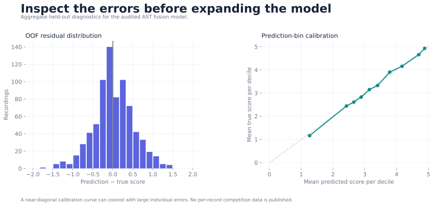
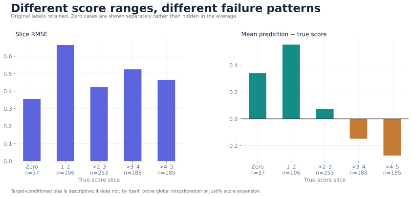
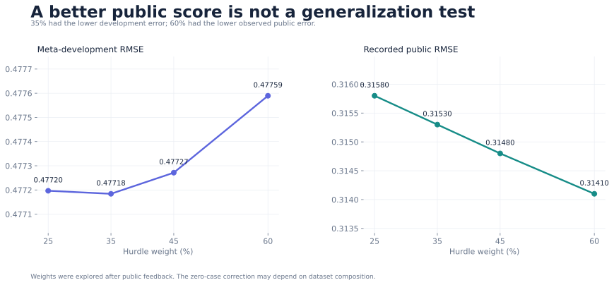

# 1. Visual results

1. **Local validation and recorded public results.** Separate panels preserve the distinction between evaluation sets. Early text baselines use six-fold OOF; the audited AST model uses three grouped folds; ensemble values are reused meta-development estimates.

   

2. **Training dynamics.** The audited AST fusion run selects different epochs in different folds. Training MSE is measured during updates; validation RMSE is computed in evaluation mode. Their scales are intentionally separate.

   

3. **Error shape and calibration.** Aggregated residuals and prediction deciles reveal different aspects of failure. Good average calibration does not eliminate large individual errors.

   

4. **Score slices.** Zero cases are separated explicitly. True-label-conditioned bias does not by itself imply that all predictions should be expanded.

   

5. **The public/development disagreement.** Hurdle weights were explored after public feedback. The weight with the best public score was not the one with the lowest development error. This experiment has dataset-discrepancy and selection risks; it is not evidence of independent generalization.

   

6. **Regenerate and inspect.** All charts use [published aggregate evidence](../reports/chart_data.json), not redistributed competition records. Run `python scripts/render_figures.py`. SVG and PNG versions are available in `docs/assets/`. Historical leaderboard values are observations from the local archive; no current leaderboard or private-test values are asserted.
